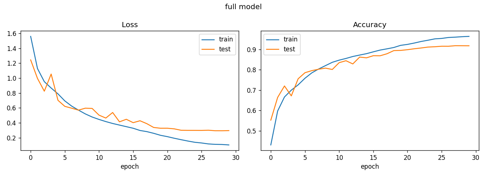
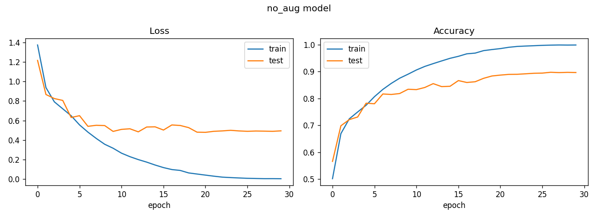
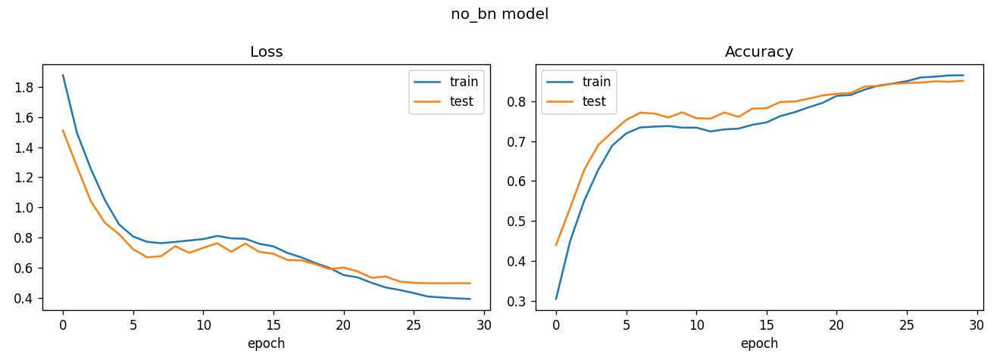
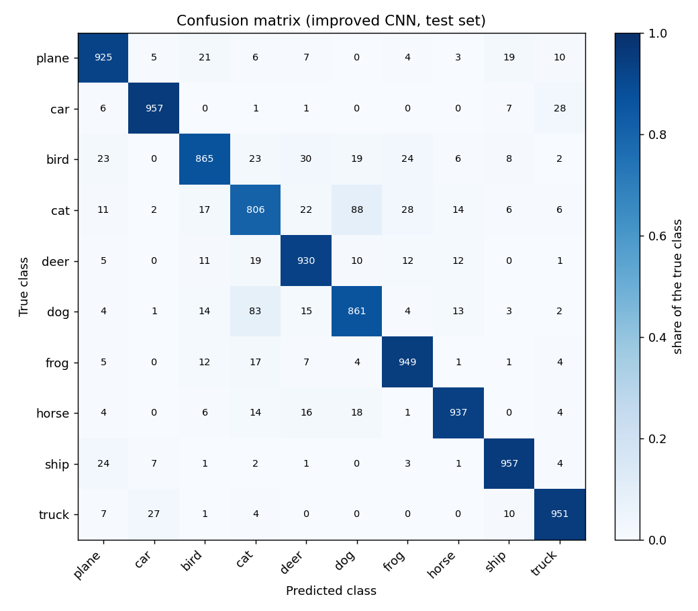
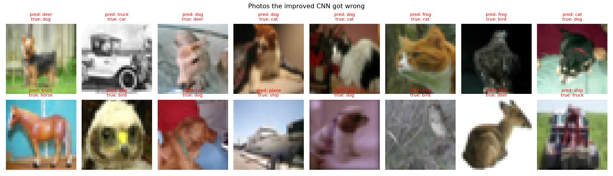
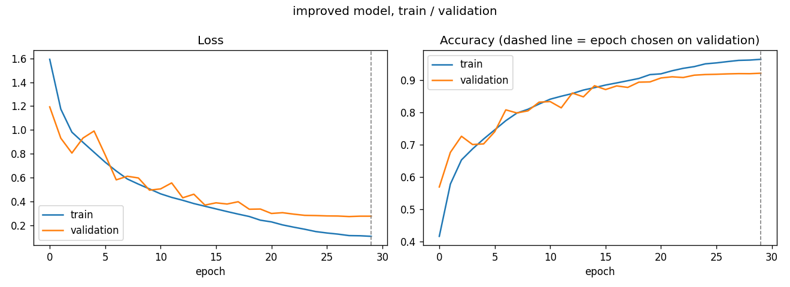
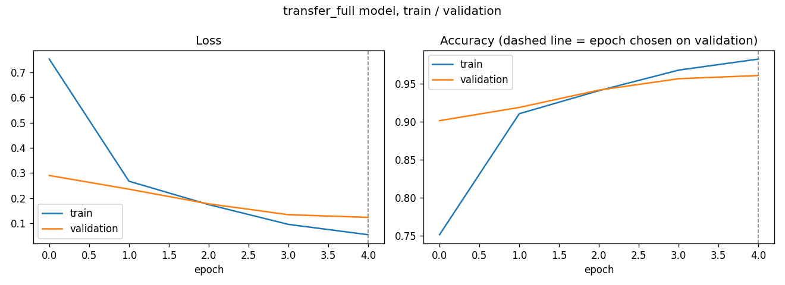

# CIFAR-10 CNN

My first deep learning project. I trained a simple CNN on CIFAR-10, watched it overfit, fixed it, ran an ablation study to see which fixes mattered, looked at where it still fails, and then tried transfer learning with a pretrained ResNet18. I also put the best model in a small Gradio demo.

CIFAR-10 is 60,000 tiny colour photos (32x32) in 10 classes: plane, car, bird, cat, deer, dog, frog, horse, ship, truck. The model has to guess what's in each photo.

Live demo: coming soon (Hugging Face Spaces)

## Results

| Model | Test accuracy | Train accuracy | Best epoch picked on |
|---|---|---|---|
| Baseline CNN | 76.01% | 97.1% | test set (final epoch: 75.0%) |
| Improved CNN | 91.38% | 96.4% | validation set |
| ResNet18, pretrained and fine-tuned | 95.54% | 98.2% | validation set |

The improved model isn't better on the training photos (97% vs 96%). It's better on photos it hasn't seen, which is what matters. The baseline number was picked on the test set (my first mistake, see Part 4), the other two were picked properly.

## Part 1: Baseline vs improved

**Baseline** (3 conv layers, 15 epochs): train accuracy kept going up but test accuracy got stuck around 75%. Test loss was lowest at epoch 4 and then started rising, so it was memorizing the training photos instead of learning.


**Improved** (30 epochs): test accuracy kept climbing and the train and test lines stayed close together.


What I changed:

- data augmentation (random crop + flip)
- batch norm
- dropout
- two conv layers per block instead of one
- AdamW + OneCycle learning rate

The sample predictions are in `images/baseline_predictions.png` and `images/improved_predictions.png` (green = right, red = wrong). The baseline mixed up a ship and a car, and a frog and a deer, which is fair at 32x32.

## Part 2: Ablation study

I changed five things at once, so I didn't know which ones did the work. To find out, I took the improved model and switched off one thing at a time (same data, same seed, 30 epochs each).

| Experiment | Best test acc | Final test acc | Final train acc | Gap (train - test) |
|---|---|---|---|---|
| full model | 91.81% | 91.77% | 96.40% | 4.6 |
| no dropout | 91.79% | 91.76% | 99.20% | 7.4 |
| no augmentation | 89.74% | 89.65% | 99.87% | 10.2 |
| no LR scheduler | 89.83% | 89.35% | 93.40% | 4.1 |
| no batch norm | 85.05% | 85.05% | 86.44% | 1.4 |

How much accuracy each one cost compared to the full model (using the best test acc column):

| Removed | Accuracy lost |
|---|---|
| dropout | ~0.0 points |
| augmentation | ~2.1 points |
| LR scheduler | ~2.0 points |
| batch norm | ~6.8 points |





(Graphs for the other two runs: `images/no_dropout_curves.png` and `images/no_sched_curves.png`.)

### What I found

- **Two different kinds of failure.** Removing dropout or augmentation made the model **overfit**: train accuracy shot up to 99%+ and the gap to test accuracy grew to 7-10 points. Removing batch norm or the scheduler made the model **learn worse**: train accuracy actually went down (86% and 93%) and the gap stayed small. So some tricks stop the model memorizing, and others help it learn efficiently.
- **Batch norm mattered most**, about 7 points. Without it the model trained much slower and hadn't caught up after 30 epochs.
- **Augmentation and the scheduler** each cost about 2 points.
- **Dropout barely changed test accuracy** here, but it clearly lowered train accuracy (99.2% to 96.4%) and shrank the gap. The other regularizers (augmentation, batch norm, weight decay) probably cover for it when it's removed.

## Part 3: Confusion matrix and error analysis

To understand where the improved CNN makes mistakes, I generated a confusion matrix on the CIFAR-10 test set (using the checkpoint picked on the validation set, 91.38% overall).



The confusion matrix shows how predictions are distributed across all 10 classes. It helps identify which classes the model distinguishes well and which classes it tends to confuse.

I also visualized some misclassified test images to examine individual prediction errors.



This provides a closer look at the model's mistakes beyond the overall test accuracy.

### What I learned

- **Overall accuracy doesn't tell the whole story.** Even with 91% test accuracy, the model performs differently across individual classes. Cat classification was the weakest at 80.6%, while cars and ships reached 95.7%.
- **Similar-looking classes are harder to distinguish.** The model frequently confused dogs with cats (83 images) and cats with dogs (88 images). That's about 1 in 5 of all its mistakes. This suggests that some visual features overlap significantly at the low 32x32 image resolution (I test this in Part 5).
- **Some classes are easier to recognize.** Cars, ships, trucks and frogs achieved relatively high classification accuracy, showing that the model learned their distinguishing features more effectively.
- **Most mistakes come from the animal classes.** The six animal classes cause about 3 out of 4 of all mistakes, while vehicle mistakes are mostly between similar vehicles (car vs truck, ship vs plane).
- **Visual inspection adds context to numerical results.** Looking at misclassified images helped me understand that some errors occur because of similar shapes, backgrounds and limited image detail.

### Key takeaway

A model achieving high overall accuracy can still struggle with specific classes. Combining a confusion matrix with misclassified image visualization gives a more complete picture of model performance.

## Part 4: Proper validation split

Up to here I was picking the "best" epoch using the test accuracy, which means the test set helped choose the result it was supposed to judge. So the numbers were a bit optimistic.

Now I split the 50,000 training photos into 45,000 for training and 5,000 for validation. The best epoch is picked on the validation set, and the test set is used once at the end.

| | Accuracy |
|---|---|
| Best validation accuracy | 92.08% (epoch 30) |
| **Test accuracy of that checkpoint** | **91.38%** |
| Final train accuracy | 96.4% |



91.38% is lower than the 91.75-92.06% I got before. Some of that is the optimistic selection, and some is that the model now trains on 45,000 photos instead of 50,000. I can't separate the two. Validation and test differ by 0.7 points, which is normal for a 5,000 photo validation set.

## Part 5: Transfer learning (testing my cat vs dog guess)

From the confusion matrix I guessed that cats and dogs get confused because a CNN trained from scratch can't pick up fine details at 32x32. To test that, I fine-tuned a ResNet18 that was pretrained on ImageNet (photos upscaled to 128x128), with the same train/validation/test split as Part 4.

| Model | Test acc | Cat | Dog | Cat/dog swaps |
|---|---|---|---|---|
| My CNN from scratch | 91.38% | 80.6% | 86.1% | 171 |
| ResNet18, only the new last layer trained (3 epochs) | 83.36% | 68.0% | 84.6% | 223 |
| ResNet18, whole network fine-tuned (5 epochs) | 95.54% | 89.8% | 92.7% | 112 |



- Fine-tuning the whole network roughly halved the mistakes (862 down to 446) and improved every class.
- Training only the new last layer was worse than my CNN, so the pretrained features needed to adapt to these blurry upscaled photos.
- Cat/dog swaps went down by about 35%, but total mistakes went down by about 48%. So cat vs dog is still the hardest pair (almost 3x the next one) and cats and dogs still cause about 39% of all mistakes. Pretraining helped, but it didn't solve it.

**Caveat:** this doesn't prove pretraining alone is the reason. ResNet18 is also about 10x bigger than my CNN and sees 128px images. To separate those I want to train the same ResNet18 from random weights (the script has `--init scratch` for this, I haven't run it yet).

## Part 6: Gradio demo

`app.py` is a small demo: upload a photo and it shows the top 3 predictions from the fine-tuned ResNet18.

My first version squashed wide photos into a square, and it called a photo of a jumping cat a deer (70% deer, 28% cat). Now it crops a centered square first and then shrinks it to 32x32, and it got the photos I tried right. It still only knows the 10 classes and always picks one, even for something else, and it works best when the animal or object is big and centered (like the training photos).

```
python app.py
```
It needs the trained weights (`transfer_full_valbest.pt`, from `python cifar10_transfer.py --mode full`). The weights are not in this repo because the file is about 45 MB.

## Caveats

- **Ablation numbers were picked on the test set.** The "best test acc" column in Part 2 uses the best epoch by test accuracy, so it's a bit optimistic. The final-epoch column is cleaner (with final-epoch numbers the accuracy lost is about 0.0, 2.1, 2.4 and 6.7 points for dropout, augmentation, scheduler and batch norm).
- **Run-to-run noise is real.** The same model got 91.75%, 92.06% and 91.81% in three runs, so any difference under about half a point (like dropout's) is basically noise.
- Each experiment was only run once, so the ranking of augmentation vs scheduler is too close to call.
- The "no scheduler" run used a constant learning rate of 1e-3, while OneCycle peaks at 3e-3, so it changes the learning rate as well as the schedule.
- The learning rate was picked with batch norm in mind, so part of the batch norm drop could be a tuning mismatch.
- Per-class accuracies come from 1,000 photos each, so a class can move by 1-2 points between runs just by chance.

## Run it

I ran everything on Colab with a free T4 GPU.

```
pip install torch torchvision matplotlib gradio

# part 1
python cifar10_cnn.py --model baseline --epochs 15
python cifar10_cnn.py --model improved --epochs 30

# part 2 (needs cifar10_cnn.py in the same folder)
python cifar10_ablation.py
python cifar10_ablation.py --no-dropout
python cifar10_ablation.py --no-aug
python cifar10_ablation.py --no-bn
python cifar10_ablation.py --no-sched

# part 3
python confusion_matrix.py --weights improved_valbest.pt

# part 4
python cifar10_validation.py --model improved --epochs 30

# part 5
python cifar10_transfer.py --mode head --epochs 3
python cifar10_transfer.py --mode full --epochs 5

# part 6
python app.py
```

The dataset downloads by itself the first time (about 170 MB, and the download was very slow for me). Each run takes between 1 and 11 min on the T4. The scripts write their outputs (graphs, csv, weights) into the folder you run them from. The graphs and csv files I kept are in `images/` and `results/`.

## Files

```
cifar10_cnn.py         models, training loop, plots (baseline and improved)
cifar10_ablation.py    same model with switches to turn parts off
cifar10_validation.py  train / validation / test split, best epoch picked on validation
confusion_matrix.py    confusion matrix, per-class accuracy, misclassified photos
cifar10_transfer.py    pretrained ResNet18 (head only or full fine-tune, or from scratch)
app.py                 Gradio demo
requirements.txt       packages for the demo
images/                graphs and sample predictions
results/               csv files with the numbers from each experiment
```

## Next

- [x] ablation study
- [x] confusion matrix and error analysis
- [x] proper validation split
- [x] transfer learning with ResNet18
- [x] Gradio demo
- [ ] control experiment: the same ResNet18 from random weights
- [ ] put the demo online (Hugging Face Spaces)
- [ ] serve the model with FastAPI and Docker
