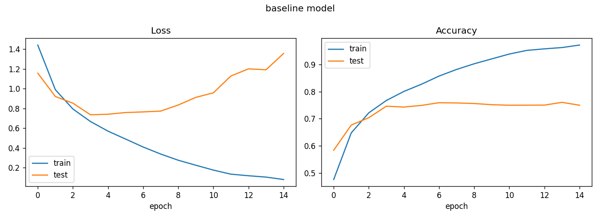
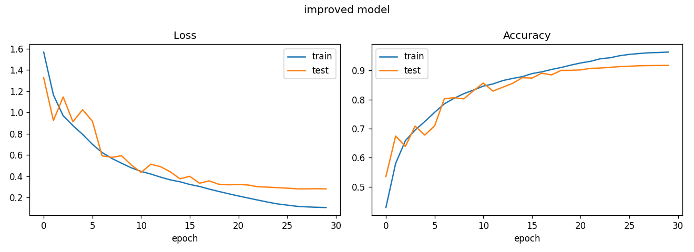
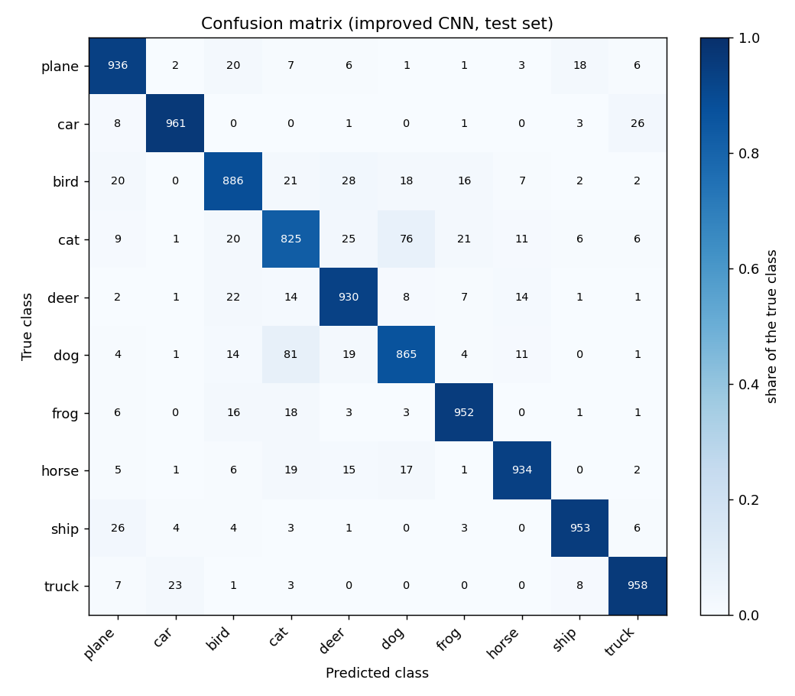
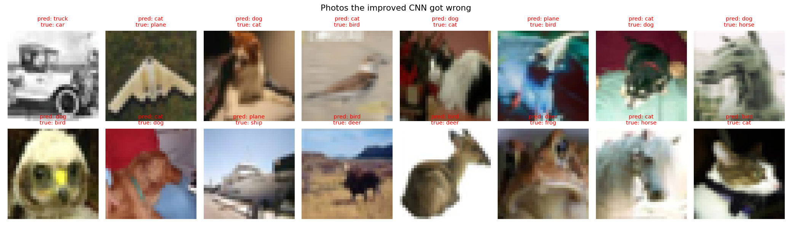

# CIFAR-10 CNN

My first deep learning project. I trained a simple CNN on CIFAR-10, watched it overfit, fixed it, and then ran an ablation study to find out which of my fixes actually mattered.

CIFAR-10 is 60,000 tiny colour photos (32x32) in 10 classes: plane, car, bird, cat, deer, dog, frog, horse, ship, truck. The model has to guess what's in each photo.

## Results

| | Test accuracy | Train accuracy |
|---|---|---|
| Baseline CNN | 76.01% | 97.1% |
| Improved CNN | ~91.8% | ~96.4% |

The improved model isn't better on the training photos (97% vs 96%). It's better on photos it hasn't seen, which is what matters.

## Part 1: Baseline vs improved

**Baseline** (3 conv layers, 15 epochs): train accuracy kept going up but test accuracy got stuck around 75%. Test loss was lowest at epoch 4 and then started rising, so it was memorizing the training photos instead of learning.



**Improved** (30 epochs): test accuracy kept climbing and the train and test lines stayed close together.



What I changed:
- data augmentation (random crop + flip)
- batch norm
- dropout
- two conv layers per block instead of one
- AdamW + OneCycle learning rate

The sample predictions are in `baseline_predictions.png` and `improved_predictions.png` (green = right, red = wrong). The baseline mixed up a ship and a car, and a frog and a deer, which is fair at 32x32.

## Part 2: Ablation study

I changed five things at once, so I didn't know which ones did the work. To find out, I took the improved model and switched off one thing at a time (same data, same seed, 30 epochs each).

| Experiment | Best test acc | Final train acc | Gap (train - test) |
|---|---|---|---|
| full model | 91.81% | 96.40% | 4.6 |
| no dropout | 91.79% | 99.20% | 7.4 |
| no augmentation | 89.74% | 99.87% | 10.2 |
| no LR scheduler | 89.83% | 93.40% | 4.1 |
| no batch norm | 85.05% | 86.44% | 1.4 |

How much accuracy each one cost compared to the full model:

| Removed | Accuracy lost |
|---|---|
| dropout | ~0.0 points |
| augmentation | ~2.1 points |
| LR scheduler | ~2.0 points |
| batch norm | ~6.8 points |


(Graphs for the other two runs are in the repo: `no_dropout_curves.png` and `no_sched_curves.png`.)


### What I found

- **Two different kinds of failure.** Removing dropout or augmentation made the model **overfit**: train accuracy shot up to 99%+ and the gap to test accuracy grew to 7-10 points. Removing batch norm or the scheduler made the model **learn worse**: train accuracy actually went down (86% and 93%) and the gap stayed small. So some tricks stop the model memorizing, and others help it learn efficiently.
- **Batch norm mattered most**, about 7 points. Without it the model trained much slower and hadn't caught up after 30 epochs.
- **Augmentation and the scheduler** each cost about 2 points.
- **Dropout barely changed test accuracy** here, but it clearly lowered train accuracy (99.2% to 96.4%) and shrank the gap. The other regularizers (augmentation, batch norm, weight decay) probably cover for it when it's removed.

## Part 3: Confusion Matrix and Error Analysis

To understand where the improved CNN makes mistakes, I generated a confusion matrix on the CIFAR-10 test set.



The confusion matrix shows how predictions are distributed across all 10 classes. It helps identify which classes the model distinguishes well and which classes it tends to confuse.

I also visualized some misclassified test images to examine individual prediction errors.



This provides a closer look at the model's mistakes beyond the overall test accuracy.

### What I Learned

- **Overall accuracy doesn't tell the whole story.** Even with 92% test accuracy, the model performs differently across individual classes. Cat classification was the weakest at 82.5%, while cars achieved 96.1%.

- **Similar-looking classes are harder to distinguish.** The model frequently confused dogs with cats (81 images) and cats with dogs (76 images). This suggests that some visual features overlap significantly at the low 32×32 image resolution.

- **Some classes are easier to recognize.** Cars, trucks, ships and frogs achieved relatively high classification accuracy, showing that the model learned their distinguishing features more effectively.

- **Visual inspection adds context to numerical results.** Looking at misclassified images helped me understand that some errors occur because of similar shapes, backgrounds and limited image detail.

### Key Takeaway

A model achieving high overall accuracy can still struggle with specific classes. Combining a confusion matrix with misclassified image visualization gives a more complete picture of model performance.

### Caveats

- **Run-to-run noise is real.** The full model got 91.75%, 92.06% and 91.81% in three separate runs with the same settings. So any difference under about half a point (like dropout's) is basically noise.
- Each experiment was only run once, so the ranking of augmentation vs scheduler (2.1 vs 2.0) is too close to call.
- The "no scheduler" run used a constant learning rate of 1e-3, while OneCycle peaks at 3e-3, so it changes the learning rate as well as the schedule.
- The learning rate was picked with batch norm in mind, so part of the 7 point drop could be a tuning mismatch. A lower learning rate or more epochs might close some of the gap.
- I saved the "best" epoch using test accuracy, so best-accuracy numbers are a bit optimistic. The final-epoch numbers are in `ablation_results.csv`.

## Run it

I ran everything on Colab with a free T4 GPU.

```
pip install torch torchvision matplotlib

# part 1
python cifar10_cnn.py --model baseline --epochs 15
python cifar10_cnn.py --model improved --epochs 30

# part 2 (needs cifar10_cnn.py in the same folder)
python cifar10_ablation.py
python cifar10_ablation.py --no-dropout
python cifar10_ablation.py --no-aug
python cifar10_ablation.py --no-bn
python cifar10_ablation.py --no-sched
```

The dataset downloads by itself the first time (about 170 MB, and the download was very slow for me). Each ablation run takes around 9-11 min on the T4. Results are added to `ablation_results.csv` after every run.

## Files
## Files

- `cifar10_cnn.py`: models, training loop, plots (baseline and improved)
- `cifar10_ablation.py`: same model with switches to turn parts off
- `confusion_matrix.py`: confusion matrix and misclassified image analysis
- `ablation_results.csv`: results of the ablation runs
- `*_curves.png`, `*_predictions.png`: graphs and sample predictions
- `confusion_matrix.png`: confusion matrix visualization
- `misclassified.png`: incorrectly classified test images

## Next

- [x] ablation study
- [x] confusion matrix and error analysis
- [ ] proper validation split (so I'm not picking the best epoch using the test set)
- [ ] try transfer learning with ResNet18
- [ ] Gradio demo
