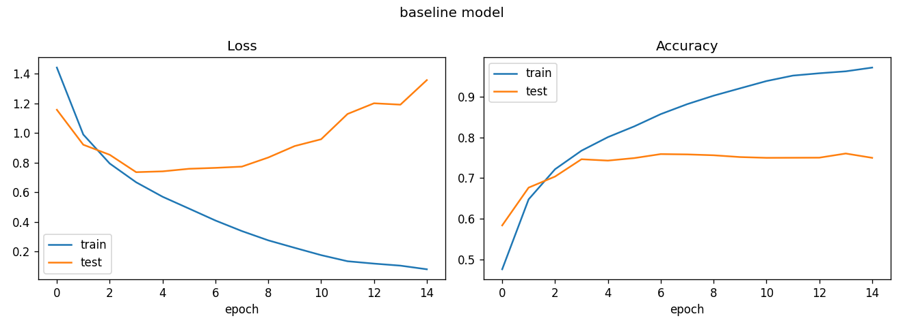
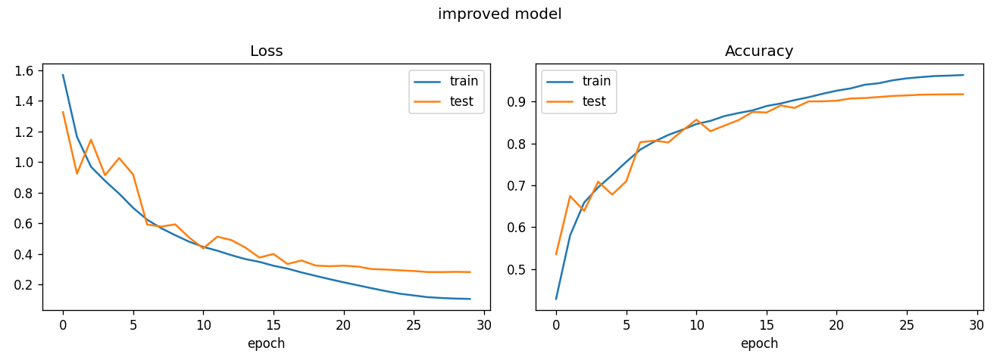

# CIFAR-10 CNN

My first deep learning project. I trained a simple CNN on CIFAR-10, saw it overfit, then fixed it.

CIFAR-10 is 60,000 tiny colour photos (32x32) in 10 classes: plane, car, bird, cat, deer, dog, frog, horse, ship, truck. The model has to guess what's in each photo.

## Results

| | Test accuracy | Train accuracy |
|---|---|---|
| Baseline | 76.01% | 97.1% |
| Improved | 91.75% | 96.3% |

The improved model isn't better on the training photos (97% vs 96%). It's better on photos it hasn't seen, which is what matters.

## What happened

**Baseline** (3 conv layers, 15 epochs): train accuracy kept going up but test accuracy got stuck around 75%. Test loss was lowest at epoch 4 and then started rising, so it was memorizing the training photos instead of learning.



**Improved** (30 epochs): test accuracy kept climbing and the train and test lines stayed close together.



What I changed:
- data augmentation (random crop + flip)
- batch norm
- dropout
- two conv layers per block instead of one
- AdamW + OneCycle learning rate

The sample predictions are in `baseline_predictions.png` and `improved_predictions.png` (green = right, red = wrong). The baseline mixed up a ship and a car, and a frog and a deer, which is fair at 32x32.

## Run it

I ran everything on Colab with a free T4 GPU.

```
pip install torch torchvision matplotlib
python cifar10_cnn.py --model baseline --epochs 15
python cifar10_cnn.py --model improved --epochs 30
```

The dataset downloads by itself the first time (about 170 MB). Baseline takes around 3 min, improved around 11 min on the T4.

## Things to keep in mind

- I saved the "best" model using test accuracy, so 91.75% is a bit optimistic. The last epoch gave 91.8% anyway, so it's not a big difference, but a proper validation split would be better.
- Each model was trained once, so I wouldn't read much into tiny differences.
